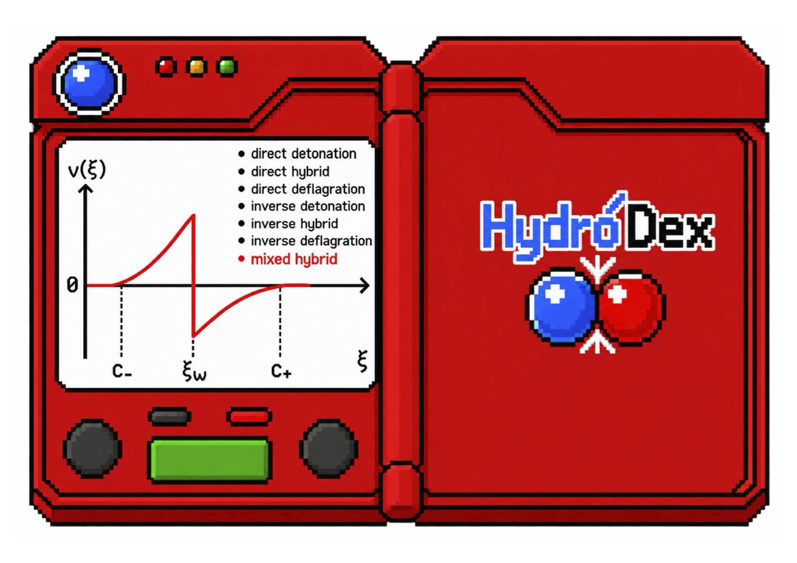

# HydróDex

[](https://github.com/hydrodex-pt/hydrodex/blob/main/LICENSE)
[](https://arxiv.org/abs/2611.17411)
[](https://hydrodex-pt.github.io/hydrodex/)
[](https://github.com/hydrodex-pt/hydrodex/actions/workflows/ci.yml)

A C++ code for the calculation of fluid profiles of direct and inverse phase 
transitions and for computing the corresponding gravitational wave spectrum 
within the sound shell model.

<div align="center">
  
  <br><br>
</div>

Contacts:
- Giulio Barni:
  [giulio.barni@desy.de](mailto:giulio.barni@desy.de)
- Eric Madge:
  [eric.madge-pimentel@durham.ac.uk](mailto:eric.madge-pimentel@durham.ac.uk)

## Table of Contents

- <a href="#description">Description</a>
- <a href="#attribution">Attribution</a>
- <a href="#installation">Installation</a>
- <a href="#usage">Usage</a>
- <a href="#changelog">Changelog</a>
- <a href="#development">Development</a>
- <a href="#license">License</a>
- <a href="#references">References</a>

## Description

This code provides the C++ library `libhydrodex`. It is structured
into four main header files:

1. The header `include/hydrodex/profile_calculator.hpp` defines the namespace
  `hydrodex::profile_calculator`, which provides the functions to calculate
  the velocity, enthalpy, energy and pressure profiles of the fluid for given
  values of the wall velocity &xi;<sub>w</sub> and transition strength
  &alpha;<sub>N</sub>.
2. The header `include/hydrodex/fluid_profile.hpp` provides the class
  `hydrodex::FluidProfile`. This class acts as a simple interface to the
  functions in `hydrodex::profile_calculator`, automatically passing the
  results from one routine to the next.
3. The header `include/hydrodex/sound_shell_model.hpp` defines the namespace
  `hydrodex::sound_shell_model` with the functions to compute the
  gravitational wave spectrum and various related quantities within the sound
  shell model.
4. The header `include/hydrodex/sound_shell_spectrum.hpp` provides the class
  `hydrodex::SoundShellSpectrum`. This is an object-oriented interface to the
  functions in `hydrodex::sound_shell_model`.

The `include` folder furthermore contains the following files:

5. The header `include/hydrodex/utils.hpp` and the corresponding namespace
  `hydrodex::utils` contain helper functions used inside the code.
6. The header `include/hydrodex/settings.hpp` defines the namespace
  `hydrodex::settings` which includes global settings, such as a flag `debug`
  for additional debug prints, or a `consistency_check` switch to control
  handling of non-critical consistency checks.
7. The header `include/hydrodex/constants.hpp` defines the namespace
  `hydrodex::constants` containing the physical and mathematical constants
  used in the code.
8. The header `include/hydrodex/version.hpp` is generated by CMake from
  `version.hpp.in` and contains the version information.

The Python module `hydrodex` provides the submodules
`hydrodex.profile_calculator` and `hydrodex.sound_shell_model` as well as the
classes `hydrodex.FluidProfile` and `hydrodex.SoundShellSpectrum` which interface
to the corresponding C++ versions.

## Attribution

If you use this code in your work, please cite
<a href="#HydroDex-paper">Barni and Madge (2026) [1]</a>.  
```bibtex
@article{Barni:2026cxi,
    author = "Barni, Giulio and Madge, Eric",
    title = "{Hydr{\'o}Dex: gotta match 'em all!}",
    eprint = "2611.17411",
    archivePrefix = "arXiv",
    primaryClass = "physics.flu-dyn",
    reportNumber = "DESY-26-161, IFT-CSIC/UAM-26-165, IPPP/26/83",
    month = "11",
    year = "2026"
}
```

## Installation

### Prerequisites 

To install and run the code, you need the following prerequisites.

#### Build Tools

- CMake ≥ 3.24
- C++17 compatible compiler (tested with Clang/GCC)
- Python ≥ 3.8 (for building the Python interface if `BUILD_PYTHONLIB=ON`)

#### Dependencies

- [Boost](https://www.boost.org/)
- [GSL (GNU Scientific Library)](https://www.gnu.org/software/gsl/)
- [OpenMP](https://www.openmp.org/)
- [pybind11](https://github.com/pybind/pybind11) ≥ 3.0.0
  (for building the Python interface if `BUILD_PYTHONLIB=ON`)
- [NumPy](https://numpy.org/) (for using the Python interface)
- [Doxygen](https://www.doxygen.nl/) ≥ 1.9.7
  (for building the documentation if `BUILD_DOCS=ON`)
- [Sphinx](https://www.sphinx-doc.org/) and the
  [Furo](https://github.com/pradyunsg/furo) theme (for building the
  documentation of the Python interface if both `BUILD_DOCS=ON` and
  `BUILD_PYTHONLIB=ON`)

### Basic Instructions

The `HydróDex` code can be installed using cmake with the following commands:
```bash
cmake -S<root_dir> -B<build_folder> -DCMAKE_INSTALL_PREFIX=<install_path>
cmake --build <build_folder> -j <N>
cmake --install <build_folder>
```
or
```bash
mkdir <build_folder> && cd <build_folder>
cmake <root_dir> -DCMAKE_INSTALL_PREFIX=<install_path>
make -j <N>
make install
```
where `<root_dir>` is the root directory of the code (i.e. the one containing
the `CMakeLists.txt` file), `<build_folder>` is the folder in which the project
will be built, `<install_path>` is the path into which the code will be 
installed, and `<N>` is the number of processes when building in parallel.

For instance, if the project root directory is `hydrodex/`, you want to build
the code in the folder `hydrodex/build` on 8 cores and install it into
`hydrodex/install`, you can go to `hydrodex/` and run
```bash
cmake -S. -Bbuild -DCMAKE_INSTALL_PREFIX=install
cmake --build build -j 8
cmake --install build
```

After installation, the `<install_path>` will contain the following files
- `lib/libhydrodex.so` or `lib/libhydrodex.dylib`  
  The shared `HydróDex` library to which you can link your code.
- `include/hydrodex/*.hpp`  
  Header files for the C++ library that you need to include to use the library.
- `bin/hydrodex/hydrodex` (if `BUILD_EXECUTABLE=ON`)  
  An executable that calculates the fluid profiles and gravitational wave
  spectrum for given input values.
- `lib/python<python version>/site-packages/hydrodex.cpython-<python version>-<platform>.so`
  (if `BUILD_PYTHONLIB=ON`)  
  Python interface to the library.
- `share/hydrodex/docs/`  
  Readme (`README.md`), changelog (`CHANGELOG.md`) and license (`LICENSE`) of
  the code, and (if `BUILD_DOCS=ON`) the HTML documentation generated with
  Doxygen in `html/`. If the Python interface is built and Sphinx is available,
  `html/python/` contains the documentation of the Python interface.
- `share/hydrodex/examples/*.ipynb`  
  Example Jupyter notebooks demonstrating the Python interface.

### Installing the Python Interface with pip

Alternatively, the Python interface can be installed directly into your current
Python environment with pip by running
```bash
pip install <root_dir>
```
This builds the Python module with CMake and installs it into the environment's
`site-packages` folder. CMake, pybind11, and the remaining build tools
are fetched automatically, but Boost, GSL and OpenMP still need to be installed
on your system (see <a href="#dependencies">Dependencies</a>).
Options and hints for CMake can be passed via the `CMAKE_ARGS` environment
variable or through pip's `--config-settings` (`-C`) option to the
`scikit-build-core` backend. The compiler can be specified using `CXX`, e.g.
```bash
CXX=/path/to/g++ pip install <root_dir>
```
or
```bash
pip install <root_dir> -C cmake.define.CMAKE_CXX_COMPILER=/path/to/g++
``` 
For development, the package can be installed in editable mode with automatic
rebuilding via
```bash
pip install --no-build-isolation -e <root_dir> -C build-dir=<python_build_dir> -C editable.rebuild=true
```
Note that the pip installation builds the Python interface separately from the
CMake build. Therefore, `<python_build_dir>` should be different from
`<build_folder>`. Since `--no-build-isolation` disables the automatic download
of the build requirements, `scikit-build-core` and `pybind11` must first be
installed into the environment, e.g. via
`pip install scikit-build-core pybind11`.


### Dependency Details

#### Compiler

This project requires a C++17-compatible compiler, such as:
- GCC >= 7
- Clang >= 6
- Apple Clang >= 10

You can select a specific compiler using environment variables:
```bash
export CXX=/path/to/g++
```
or pass it directly to CMake:
```bash
cmake -DCMAKE_CXX_COMPILER=/path/to/clang++ ..
```

#### OpenMP

OpenMP is used for parallel computation. CMake will automatically find it if
available. If not detected:
- Install the relevant OpenMP development package (e.g. `libomp-dev` on
  Debian/Ubuntu, or `libomp` via MacPorts or Homebrew on macOS).
- If you have a compiler with working OpenMP but CMake complains about not
  finding OpenMP, make sure that it is using the correct compiler (see
  <a href="#compiler">above</a>). E.g., to use the compiler that is invoked when
  you call `g++` in the terminal, you can use the option
  `-DCMAKE_CXX_COMPILER=$(which g++)`.
- If necessary, set: `-DOpenMP_CXX_FLAGS="-fopenmp"`,
  `-DOpenMP_CXX_LIB_NAMES="omp"` and `-DOpenMP_omp_LIBRARY=/path/to/libomp.a`


#### GSL

The GNU Scientific Library is required for evaluating the cosine and sine
integrals in the integration of the time dependence of the anisotropic stress
unequal time correlator. If it is not detected automatically, you can help
CMake find it by setting `-DGSL_ROOT_DIR=/path/to/gsl`. If GSL is installed via
a package manager, you can use `pkg-config gsl --variable=prefix` to locate it.

Note that GSL aborts the program on errors by default. The Python module turns
this off on import, so that such errors raise exceptions. In C++, call
`hydrodex::settings::set_gsl_abort_on_error(false)` to do the same.

#### Boost

The `HydróDex` code uses the Boost library for root finding. If Boost is not
found automatically, you can, depending on your CMake version, provide one of
the following hints:
- For CMake >= 3.30 (i.e. with policy [`CMP0167`](
    https://cmake.org/cmake/help/latest/policy/CMP0167.html#policy:CMP0167
  ) set to `NEW`), you can provide the path to Boost's `BoostConfig.cmake` CMake
  configuration file via the `-DBoost_DIR=/path/to/boost/cmake` option, e.g.
  for Boost-1.81 installed with MacPorts:
  ```bash
  cmake -DBoost_DIR=/opt/local/libexec/boost/1.81/lib/cmake/Boost-1.81.0
  ```
- For older CMake versions (i.e. with policy [`CMP0167`](
    https://cmake.org/cmake/help/latest/policy/CMP0167.html#policy:CMP0167
  ) set to `OLD`), you can provide the path to Boost's installation prefix via
  the `-DBoost_ROOT=/path/to/boost/root` option, e.g.
  ```bash
  cmake -DBoost_ROOT=/opt/local/libexec/boost/1.81/
  ```
  You might also have to provide `BOOST_INCLUDEDIR` and `BOOST_LIBRARYDIR`.

#### Python3

Python3 is an optional dependency required for building the Python interface.
If CMake does not find it automatically, or if you want to use a specific
Python version installed on your system, you can provide the path via
`-DPython3_ROOT_DIR=/path/to/python/root`. You can obtain the path from the
corresponding `python3-config` executable by
```bash
python3-config --prefix
```

#### pybind11

Pybind11 is optional but required if the Python interface is built. You can
provide the paths to the package's CMake configuration file with
`-Dpybind11_DIR=/path/to/pybind11/cmake`, which can be found via
```bash
python3 -m pybind11 --cmakedir
```
If CMake still complains about not finding pybind11, make sure that it is using
the corresponding Python3 interpreter (cf. <a href="#python3">Python3</a>).

#### Doxygen

Doxygen is optional and required only for generating documentation. This step
can be skipped by setting `-DBUILD_DOCS=OFF`. Version 1.9.7 or newer is
required. If your doxygen executable is not in a standard path, or if an older
version is found first, you can set the path explicitly with
`-DDOXYGEN_EXECUTABLE=/path/to/doxygen`.

#### Sphinx

Sphinx and the Furo theme are optional and required only for generating the
documentation of the Python interface, which is built together with the Doxygen
documentation if `BUILD_PYTHONLIB=ON`. The documentation is generated from the
docstrings of the compiled Python module. Sphinx and Furo must be installed for
the Python interpreter used by CMake (cf. <a href="#python3">Python3</a>).
If they are not found, the documentation is built without the Python interface.

### Configuration

Pass `-D<OPTION>=<ON|OFF>` to the cmake configuration command
(`cmake -S<root_dir> -B<build_folder>` or `cmake <root_dir>`) to switch the
option `<OPTION>` on or off.

The following options control which components of the code are built:

- `BUILD_PYTHONLIB`
  Whether to build (and install) the Python interface. Building the interface
  requires Python and pybind11. This option is set to `ON` by default.
- `BUILD_DOCS`
  Whether to build (and install) the documentation. Building the documentation
  requires Doxygen. This option is set to `ON` by default.  
  If in addition `BUILD_PYTHONLIB` is set to `ON`, building the documentation
  of the Python interface additionally requires Sphinx and Furo.
- `BUILD_EXECUTABLE`
  Whether to build (and install) the `hydrodex` executable. This option is set
  to `ON` by default.

Furthermore, you can control the building process using
- `CMAKE_POSITION_INDEPENDENT_CODE`
  Generate position independent code (`-fPIC` flag). This option is set to `ON`
  by default.
- `CMAKE_INTERPROCEDURAL_OPTIMIZATION`
  Use link-time optimization (`-flto` flag). This option is set to `ON` by
  default.
- `OPTIMIZE_NATIVE`
  Optimize the code for the specific machine architecture (`-march=native`
  flag). This option is set to `ON` by default.
- `DEVELOPMENT_WARNINGS`
  Show compilation warnings (`-Wall` flag, for development). This option is set
  to `OFF` by default. Use the `--verbose` option in the build process to see
  the warnings.
- `VECTORIZATION_REPORTS`
  Show vectorization status reports (`-Rpass=loop-vectorize` and
  `-Rpass-missed=loop-vectorize` flags, for development). This option is set to
  `OFF` by default. Use the `--verbose` option in the build process to see the
  reports.
- `QUIET_DOXYGEN`
  Only display warnings and errors when creating the documentation. This option
  is set to `ON` by default.

## Usage

Please consult the [online documentation](https://hydrodex-pt.github.io/hydrodex/)
or the html documentation in the `docs` folder for the C++ library, or use the
`help` function in Python.

A [tutorial](https://github.com/hydrodex-pt/hydrodex/blob/main/examples/HydroDex_tutorial.ipynb)
Jupyter notebook and the code for
[reproducing the figures](https://github.com/hydrodex-pt/hydrodex/blob/main/examples/HydroDex_paper_figures.ipynb)
in <a href="#HydroDex-paper">Ref. [1]</a> can be found in the `examples/`
folder.

## Changelog

The changes between the released versions of `HydróDex` are listed in the
[CHANGELOG](CHANGELOG.md). `HydróDex` is the successor of
[inverse_pt](https://github.com/eric-madge/inverse_pt).

## Development

Every push to and pull request for the `main` branch is checked by the
[CI workflow](https://github.com/hydrodex-pt/hydrodex/actions/workflows/ci.yml),
which builds the library, the executable, the Python interface and the
documentation, and runs a smoke test of the Python interface
(`tests/smoke_test.py`) and of the executable. Changes to `main` are made via
pull requests, which can only be merged once the check `build-and-test` has
passed. For pushes to `main`, the documentation is published at
[hydrodex-pt.github.io/hydrodex](https://hydrodex-pt.github.io/hydrodex/).

The workflow can also be run manually for any branch, either from the
*Actions* tab on GitHub (*Run workflow*) or with the GitHub CLI:
```
gh workflow run ci.yml --ref <branch>
```
Alternatively, it can be run locally with [act](https://github.com/nektos/act).
The smoke test can also be run on a local build with
```
python tests/smoke_test.py <build directory>
```

## License

The `HydróDex` code is licensed under the GNU General Public License, version
3 or later. See the accompanying
[LICENSE file](https://github.com/hydrodex-pt/hydrodex/blob/main/LICENSE) for
further details.

## References

<ol>
<li><a id="HydroDex-paper"></a>
  G. Barni and E. Madge,<br>
  <em><code>HydróDex</code>: gotta match 'em all!</em>,<br>
  [<a href="https://arxiv.org/abs/2611.17411">arXiv:2611.17411
  [physics.flu-dyn]</a>].
</li>
<li><a id="HydroDex-letter"></a>
  G. Barni and E. Madge,<br>
  <em>Microscopic Realizability of Non-unique Bubble Hydrodynamics</em>,<br>
  [<a href="https://arxiv.org/abs/2611.17402">arXiv:2611.17402 [hep-ph]</a>].
</li>
<li><a id="GWs-inverse-PT"></a>
  G. Barni, S. Blasi, E. Madge and M. Vanvlasselaer,<br>
  <em>Gravitational waves from the sound shell model: direct and inverse
  phase transitions in the early Universe</em>,<br>
  <a href="https://doi.org/10.1088/1475-7516/2026/03/066">JCAP <b>03</b>
  (2026) 066</a>
  [<a href="https://arxiv.org/abs/2510.21439">arXiv:2510.21439 [hep-ph]</a>].
</li>
</ol>